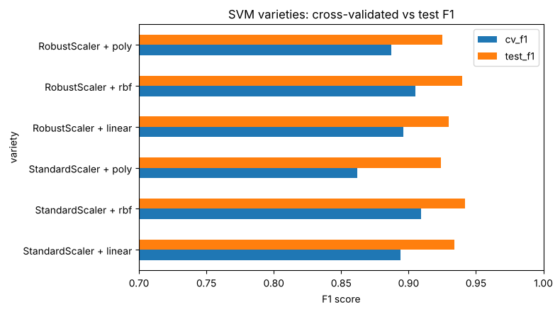
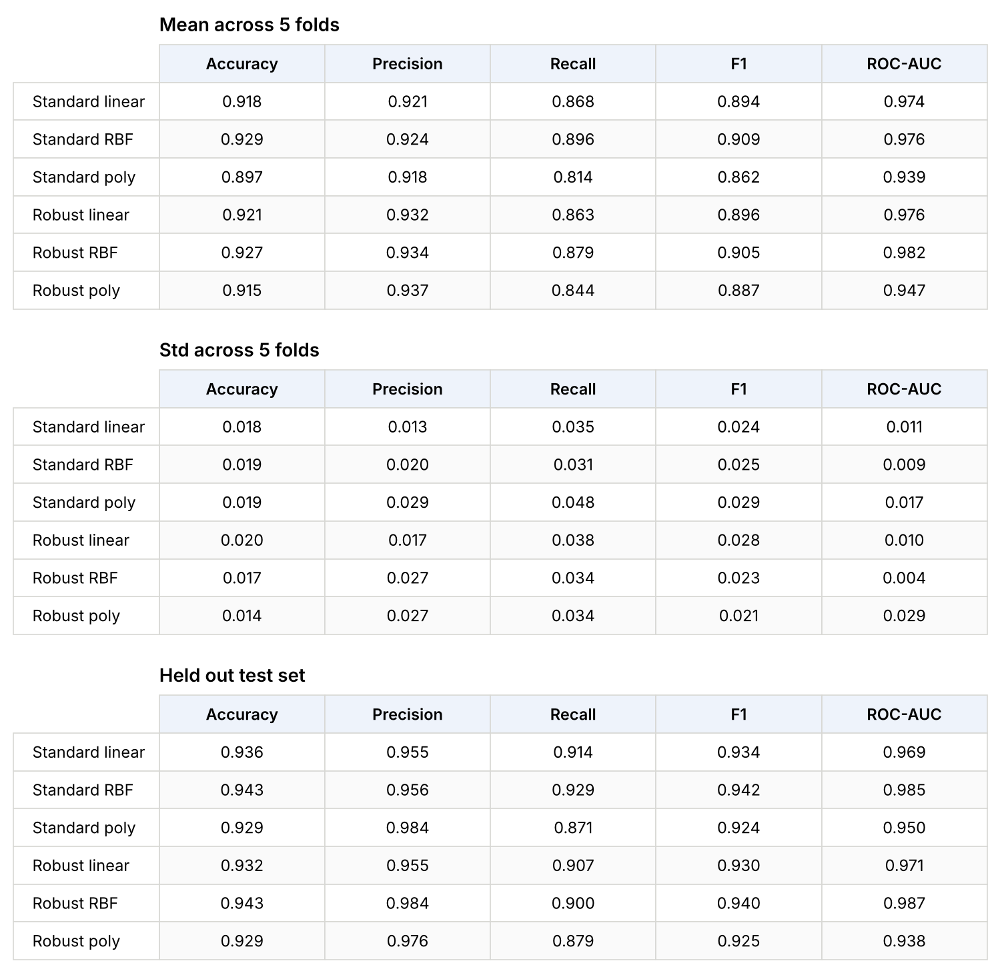
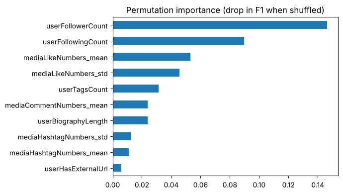
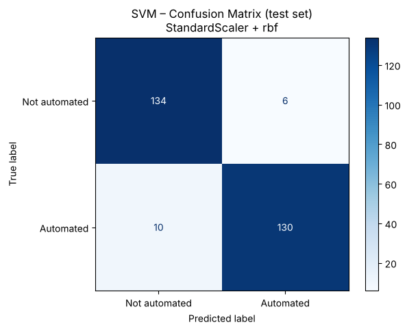

# Detecting Automated Instagram Accounts with Support Vector Machines

Classifying Instagram accounts as **human or automated** from account- and post-level
behaviour, using a Support Vector Machine tuned across 6 variants.

**Result: 94.3% accuracy / 0.942 F1 on a held-out test set.**

The more interesting finding is below: feature scaling moved test F1 from **0.797 to 0.940**
on the same model and the same data.

---

## Results

| | |
|---|---|
| Best variant | `StandardScaler` → `SVC(kernel="rbf", C=100, gamma=0.01)` |
| Cross-validated F1 | **0.909** (± 0.025) |
| Test F1 | **0.942** |
| Test accuracy | **0.943** |
| Test precision / recall | 0.956 / 0.929 |
| Variants trained | 6 (2 scalers × 3 kernels), 290 model fits |



Full per-variant metrics, cross-validated and on the test set:



---

## What the data looks like

The [InstaFake](https://github.com/fcakyon/instafake-dataset) `automated-v1.0` subset:
1,400 accounts, balanced 700 human / 700 automated.

Most columns are simple account scalars (follower count, bio length, username length), but
six are **list-valued** — one entry per post, covering likes, comments, hashtags, upload
timestamps and location flags. Those have to be collapsed into account-level summaries before
any model can use them:

| Signal | Feature |
|---|---|
| Bots post on a scheduler, so gaps between posts are regular | mean / std of inter-post interval |
| Engagement is flat and inorganic | mean / std of likes and comments per post |
| Hashtags are used for reach | mean / std of hashtags per post |
| Location metadata is rarely genuine | share of posts with location info |

After feature engineering: **19 features**, 920 training rows and 280 test rows.

---

## The main finding: scaling is not optional for an SVM

An SVM classifies by measuring **distances** between points. In this dataset
`userFollowerCount` reaches into the millions while `userHasExternalUrl` is 0 or 1 — so
without scaling, the follower count drowns out every other signal.

Same model, same data, the only difference being a scaler:

| | Test F1 |
|---|---|
| No scaling | 0.797 |
| `StandardScaler` | **0.940** |

This is specific to distance- and gradient-based models. A decision tree or random forest
would be completely unaffected, because tree splits depend on the *order* of values, not
their magnitude.

Once scaled, the choice between `StandardScaler` and `RobustScaler` made almost no
difference — within 0.01 CV F1 on every kernel. What mattered was scaling at all.

---

## How the model was built

```
for scaler in [StandardScaler, RobustScaler]:
    for kernel in [linear, rbf, poly]:
        Pipeline([scaler, SVC(kernel)])
        └── GridSearchCV over C, gamma, degree
            └── StratifiedKFold(5, shuffle=True, random_state=42)
```

- **6 variants** = 2 scalers × 3 kernels. The kernel is a structural choice, not a dial —
  each one is a different decision-boundary shape.
- **290 model fits**: every hyperparameter combination evaluated on all 5 folds.
- The scaler sits **inside** the `Pipeline`, so it is refitted on each training fold.
  Scaling before splitting is the classic leakage mistake and inflates scores.
- Variant selection was made on **cross-validated** F1. The test set was scored once,
  after the choice was fixed — selecting on test performance would invalidate it as a
  held-out estimate.

### Why F1 rather than accuracy

The preprocessing step removes outliers from the training set only, and it removes them
asymmetrically: the training set goes from 560/560 to **555 human / 365 automated**, because
extreme values *are* the bot signal. Tuning on accuracy would have rewarded a model that
simply favours the majority class. The test set stays balanced at 140/140, so accuracy is
still meaningful there.

---

## What the model relies on



An RBF SVM has no coefficients to read — the boundary lives in the transformed kernel space —
so feature influence is measured by shuffling each column and recording the drop in F1.

Follower and following counts dominate, with the engineered post-level features
(`mediaLikeNumbers_mean`, `mediaLikeNumbers_std`) next. Reported as measured: the posting-rhythm
features contributed less than expected.

---

## Errors



On 280 test accounts: **6 real users wrongly flagged**, **10 bots missed**.

Recall (0.929) sits below precision (0.956), so the model leans toward predicting "not a bot".
That follows directly from the training imbalance described above. For a platform the trade-off
is arguably the right way round — wrongly suspending real users is worse than missing some
bots — but it is a consequence of the preprocessing, not a deliberate choice.

---

## Limitations

- **920 training rows** is small. The ±0.025 CV standard deviation means differences under
  roughly 0.03 F1 between variants are not meaningful.
- **The outlier filter removes 35% of the bot class** against under 1% of humans. The model
  trains on a skewed version of the problem and is tested on a balanced one.
- **No probability calibration.** `SVC` returns a decision score, not a probability;
  `CalibratedClassifierCV` would be needed to set an operating threshold deliberately.
- **The data was collected in 2018.** Bot behaviour has changed since, so these figures
  should not be read as current-day detection performance.
- A random split can place behaviourally near-identical accounts from the same bot farm in
  both train and test, which likely inflates all scores.

**Next steps:** `class_weight="balanced"` to correct the induced imbalance, nested
cross-validation for an unbiased generalisation estimate, and a grouped split if account
provenance were available.

---

## Running it

```bash
pip install -r requirements.txt

# the dataset is not redistributed here (CC BY-NC 4.0) - fetch it from the source:
git clone https://github.com/fcakyon/instafake-dataset.git /tmp/instafake
cp -r /tmp/instafake/data/automated-v1.0 data/raw/

jupyter notebook SVM_automated.ipynb
```

Runs top to bottom in about a minute. Outputs are already embedded, so the notebook can be
read without running anything.

`random_state=42` is fixed on the split, every CV fold and the estimator, so every figure
reproduces exactly.

---

## Notebook contents

| § | Content |
|---|---|
| 1 | Feature engineering — collapsing the list columns into account-level statistics |
| 2 | Loading, class balance, the train/test imbalance |
| 3 | Why an SVM, and the scaling demonstration |
| 4 | Tuning the 6 variants with GridSearchCV |
| 5 | Selecting the best variant on cross-validated F1 |
| 6 | Test-set evaluation and confusion matrix |
| 7 | Permutation importance |
| 8 | Conclusion and limitations |

---

## Data and attribution

Dataset: **InstaFake** — <https://github.com/fcakyon/instafake-dataset>, licensed
**CC BY-NC 4.0**. Not redistributed in this repository; see the download step above.

> F. C. Akyon and M. E. Kalfaoglu, "Instagram Fake and Automated Account Detection,"
> arXiv:1910.03090, 2019. <https://arxiv.org/abs/1910.03090>

Built as the individual component of a university machine learning group project.

## Tech

Python · scikit-learn · pandas · NumPy · matplotlib · seaborn
